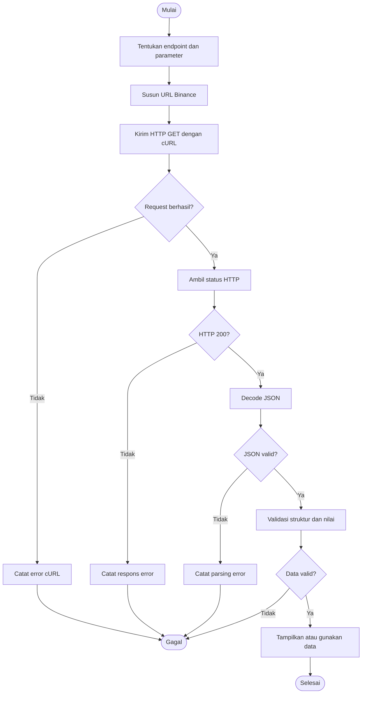
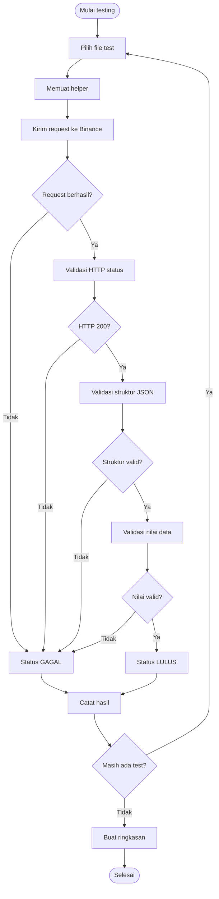
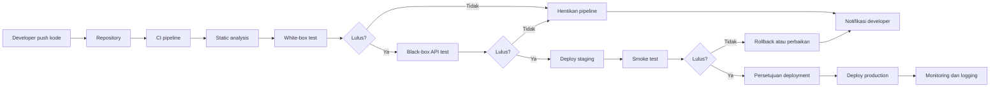

# Binance Spot API Automated Testing dengan PHP

Proyek ini merupakan implementasi pengambilan data pasar cryptocurrency dari **Binance Spot Market Data API** serta pengujian otomatis menggunakan PHP.

Studi kasus berfokus pada pasangan perdagangan:

```text
BTCUSDT
```

Dokumen ini ditujukan sebagai panduan teknis bagi Developer, QA, DevOps, Project Manager, dan Product Development.

---

## Daftar Isi

1. [Tujuan Proyek](#1-tujuan-proyek)
2. [Deskripsi Sistem](#2-deskripsi-sistem)
3. [API Binance](#3-api-binance)
4. [Persyaratan Sistem](#4-persyaratan-sistem)
5. [Struktur Proyek](#5-struktur-proyek)
6. [Instalasi](#6-instalasi)
7. [Helper Pengujian](#7-helper-pengujian)
8. [Daftar Test Case](#8-daftar-test-case)
9. [Kode Test Case](#9-kode-test-case)
10. [Menjalankan Pengujian](#10-menjalankan-pengujian)
11. [Black-Box Testing](#11-black-box-testing)
12. [White-Box Testing](#12-white-box-testing)
13. [Flowchart](#13-flowchart)
14. [Penanganan Error](#14-penanganan-error)
15. [Integrasi CI/CD](#15-integrasi-cicd)
16. [Keamanan](#16-keamanan)
17. [Rekomendasi Produksi](#17-rekomendasi-produksi)
18. [Kesimpulan](#18-kesimpulan)

---

## 1. Tujuan Proyek

Proyek ini bertujuan untuk:

- Memastikan konektivitas aplikasi dengan Binance.
- Mengambil data pasar `BTCUSDT`.
- Memvalidasi status HTTP dan struktur JSON.
- Memastikan harga, volume, order book, dan transaksi valid.
- Mengimplementasikan tujuh test case otomatis.
- Mendukung proses quality gate pada pipeline CI/CD.
- Mengurangi risiko kegagalan integrasi sebelum deployment.

---

## 2. Deskripsi Sistem

Aplikasi PHP mengirim request HTTPS ke Binance Public Market Data API. Binance mengembalikan respons JSON yang kemudian divalidasi oleh test script.

```text
Test Script PHP
      |
      | HTTPS GET
      v
Binance Spot Market Data API
      |
      | JSON Response
      v
Validasi HTTP, struktur, dan nilai
      |
      v
LULUS / GAGAL
```

Endpoint public market data tidak memerlukan API key.

---

## 3. API Binance

### Base URL

```text
https://data-api.binance.vision
```

### Dokumentasi resmi

```text
https://developers.binance.com/docs/binance-spot-api-docs/rest-api/market-data-endpoints
```

### Endpoint yang digunakan

| No. | Fitur | Method | Endpoint |
|---:|---|---|---|
| 1 | Ping server | GET | `/api/v3/ping` |
| 2 | Waktu server | GET | `/api/v3/time` |
| 3 | Informasi simbol | GET | `/api/v3/exchangeInfo` |
| 4 | Harga terbaru | GET | `/api/v3/ticker/price` |
| 5 | Candlestick | GET | `/api/v3/klines` |
| 6 | Order book | GET | `/api/v3/depth` |
| 7 | Transaksi terbaru | GET | `/api/v3/trades` |

### Contoh request

```bash
curl "https://data-api.binance.vision/api/v3/ticker/price?symbol=BTCUSDT"
```

Contoh respons:

```json
{
  "symbol": "BTCUSDT",
  "price": "68450.12000000"
}
```

Harga pada respons hanya contoh dan berubah mengikuti kondisi pasar.

---

## 4. Persyaratan Sistem

- PHP 8.0 atau lebih baru
- Ekstensi PHP cURL
- Koneksi internet
- Akses HTTPS ke Binance

Periksa versi PHP:

```bash
php --version
```

Periksa ekstensi cURL:

```bash
php -m | grep curl
```

Pada Windows:

```powershell
php -m | findstr curl
```

Jika cURL belum aktif, aktifkan ekstensi berikut pada `php.ini`:

```ini
extension=curl
```

---

## 5. Struktur Proyek

```text
binance-api-testing/
├── binance-test-helper.php
├── test-binance-ping.php
├── test-binance-server-time.php
├── test-binance-exchange-info.php
├── test-binance-ticker-price.php
├── test-binance-klines.php
├── test-binance-order-book.php
├── test-binance-recent-trades.php
├── run-all-tests.php
└── README.md
```

---

## 6. Instalasi

Clone atau salin proyek:

```bash
git clone <URL_REPOSITORY>
cd binance-api-testing
```

Tidak diperlukan API key untuk endpoint yang digunakan.

Uji koneksi langsung:

```bash
curl "https://data-api.binance.vision/api/v3/ping"
```

Respons yang diharapkan:

```json
{}
```

---

## 7. Helper Pengujian

Buat file `binance-test-helper.php`:

```php
<?php

declare(strict_types=1);

function requestBinance(string $endpoint, array $params = []): array
{
    $baseUrl = 'https://data-api.binance.vision';
    $url = $baseUrl . $endpoint;

    if (!empty($params)) {
        $url .= '?' . http_build_query($params);
    }

    $curl = curl_init($url);

    if ($curl === false) {
        throw new RuntimeException('Gagal menginisialisasi cURL');
    }

    curl_setopt_array($curl, [
        CURLOPT_RETURNTRANSFER => true,
        CURLOPT_CONNECTTIMEOUT => 10,
        CURLOPT_TIMEOUT => 30,
        CURLOPT_HTTPHEADER => [
            'Accept: application/json',
            'User-Agent: Binance-PHP-Automated-Test/1.0'
        ]
    ]);

    $response = curl_exec($curl);
    $statusCode = curl_getinfo($curl, CURLINFO_HTTP_CODE);
    $error = curl_error($curl);

    curl_close($curl);

    if ($response === false) {
        throw new RuntimeException("Request gagal: $error");
    }

    try {
        $body = json_decode(
            $response,
            true,
            512,
            JSON_THROW_ON_ERROR
        );
    } catch (JsonException $exception) {
        throw new RuntimeException(
            'Respons JSON tidak valid: ' . $exception->getMessage()
        );
    }

    return [
        'url' => $url,
        'status' => $statusCode,
        'body' => $body
    ];
}

function check(bool $condition, string $message): void
{
    if (!$condition) {
        throw new RuntimeException("GAGAL: $message");
    }
}

function pass(string $message): void
{
    echo "LULUS: $message" . PHP_EOL;
}
```

---

## 8. Daftar Test Case

### Black-box

| ID | Skenario | Ekspektasi |
|---|---|---|
| BB-01 | Ping server | HTTP 200 dan objek kosong |
| BB-02 | Waktu server | Terdapat `serverTime` |
| BB-03 | Informasi `BTCUSDT` | Simbol ditemukan |
| BB-04 | Harga `BTCUSDT` | Harga lebih dari 0 |
| BB-05 | Lima candlestick | Terdapat lima data |
| BB-06 | Order book | Terdapat `bids` dan `asks` |
| BB-07 | Transaksi terbaru | Terdapat lima transaksi |

### White-box

| ID | Logika yang diuji | Ekspektasi |
|---|---|---|
| WB-01 | Parameter kosong | URL tidak memiliki query string |
| WB-02 | Parameter terisi | Query string tersusun benar |
| WB-03 | Kegagalan cURL | Melempar exception |
| WB-04 | Validasi status | Status selain 200 ditolak |
| WB-05 | Konversi harga | Harga menjadi angka positif |
| WB-06 | Iterasi candlestick | Setiap data memiliki minimal 12 field |
| WB-07 | Iterasi transaksi | ID, harga, dan kuantitas valid |

> Endpoint Binance diuji secara black-box. White-box diterapkan pada source code PHP karena kode internal Binance tidak tersedia.

---

## 9. Kode Test Case

### 9.1 `test-binance-ping.php`

```php
<?php
require 'binance-test-helper.php';

$result = requestBinance('/api/v3/ping');

check($result['status'] === 200, 'HTTP harus 200');
check($result['body'] === [], 'Respons harus objek JSON kosong');

pass('Server Binance dapat diakses');
```

### 9.2 `test-binance-server-time.php`

```php
<?php
require 'binance-test-helper.php';

$result = requestBinance('/api/v3/time');

check($result['status'] === 200, 'HTTP harus 200');
check(isset($result['body']['serverTime']), 'serverTime tidak tersedia');
check(is_int($result['body']['serverTime']), 'serverTime harus integer');
check($result['body']['serverTime'] > 0, 'serverTime tidak valid');

pass('Waktu server tersedia');
```

### 9.3 `test-binance-exchange-info.php`

```php
<?php
require 'binance-test-helper.php';

$result = requestBinance('/api/v3/exchangeInfo', [
    'symbol' => 'BTCUSDT'
]);

check($result['status'] === 200, 'HTTP harus 200');
check(!empty($result['body']['symbols']), 'Data simbol kosong');
check(
    $result['body']['symbols'][0]['symbol'] === 'BTCUSDT',
    'Simbol harus BTCUSDT'
);

pass('Informasi BTCUSDT tersedia');
```

### 9.4 `test-binance-ticker-price.php`

```php
<?php
require 'binance-test-helper.php';

$result = requestBinance('/api/v3/ticker/price', [
    'symbol' => 'BTCUSDT'
]);

check($result['status'] === 200, 'HTTP harus 200');
check(
    ($result['body']['symbol'] ?? null) === 'BTCUSDT',
    'Simbol tidak sesuai'
);
check(isset($result['body']['price']), 'Field price tidak tersedia');
check((float) $result['body']['price'] > 0, 'Harga tidak valid');

pass('Harga BTCUSDT tersedia');
```

### 9.5 `test-binance-klines.php`

```php
<?php
require 'binance-test-helper.php';

$result = requestBinance('/api/v3/klines', [
    'symbol' => 'BTCUSDT',
    'interval' => '1h',
    'limit' => 5
]);

check($result['status'] === 200, 'HTTP harus 200');
check(count($result['body']) === 5, 'Harus terdapat 5 candlestick');

foreach ($result['body'] as $index => $candle) {
    check(
        count($candle) >= 12,
        "Struktur candlestick indeks $index tidak lengkap"
    );
    check((float) $candle[1] > 0, 'Harga open tidak valid');
    check((float) $candle[4] > 0, 'Harga close tidak valid');
}

pass('Lima candlestick tersedia dan valid');
```

### 9.6 `test-binance-order-book.php`

```php
<?php
require 'binance-test-helper.php';

$result = requestBinance('/api/v3/depth', [
    'symbol' => 'BTCUSDT',
    'limit' => 5
]);

check($result['status'] === 200, 'HTTP harus 200');
check(isset($result['body']['lastUpdateId']), 'lastUpdateId tidak tersedia');
check(isset($result['body']['bids']), 'bids tidak tersedia');
check(isset($result['body']['asks']), 'asks tidak tersedia');
check(count($result['body']['bids']) <= 5, 'Bids melebihi batas');
check(count($result['body']['asks']) <= 5, 'Asks melebihi batas');

pass('Order book BTCUSDT tersedia');
```

### 9.7 `test-binance-recent-trades.php`

```php
<?php
require 'binance-test-helper.php';

$result = requestBinance('/api/v3/trades', [
    'symbol' => 'BTCUSDT',
    'limit' => 5
]);

check($result['status'] === 200, 'HTTP harus 200');
check(count($result['body']) === 5, 'Harus terdapat 5 transaksi');

foreach ($result['body'] as $index => $trade) {
    check(isset($trade['id']), "ID transaksi indeks $index tidak tersedia");
    check((float) ($trade['price'] ?? 0) > 0, 'Harga tidak valid');
    check((float) ($trade['qty'] ?? 0) > 0, 'Kuantitas tidak valid');
}

pass('Lima transaksi terbaru tersedia dan valid');
```

---

## 10. Menjalankan Pengujian

Jalankan satu per satu:

```bash
php test-binance-ping.php
php test-binance-server-time.php
php test-binance-exchange-info.php
php test-binance-ticker-price.php
php test-binance-klines.php
php test-binance-order-book.php
php test-binance-recent-trades.php
```

### Menjalankan seluruh test

Buat `run-all-tests.php`:

```php
<?php

$tests = [
    'test-binance-ping.php',
    'test-binance-server-time.php',
    'test-binance-exchange-info.php',
    'test-binance-ticker-price.php',
    'test-binance-klines.php',
    'test-binance-order-book.php',
    'test-binance-recent-trades.php'
];

$passed = 0;
$failed = 0;

foreach ($tests as $test) {
    echo PHP_EOL . "Menjalankan $test" . PHP_EOL;

    passthru(
        escapeshellarg(PHP_BINARY) . ' ' . escapeshellarg($test),
        $exitCode
    );

    if ($exitCode === 0) {
        $passed++;
    } else {
        $failed++;
    }
}

echo PHP_EOL;
echo "Lulus : $passed" . PHP_EOL;
echo "Gagal : $failed" . PHP_EOL;

exit($failed > 0 ? 1 : 0);
```

Jalankan:

```bash
php run-all-tests.php
```

Contoh hasil:

```text
LULUS: Server Binance dapat diakses
LULUS: Waktu server tersedia
LULUS: Informasi BTCUSDT tersedia
LULUS: Harga BTCUSDT tersedia
LULUS: Lima candlestick tersedia dan valid
LULUS: Order book BTCUSDT tersedia
LULUS: Lima transaksi terbaru tersedia dan valid

Lulus : 7
Gagal : 0
```

---

## 11. Black-Box Testing

Black-box testing memvalidasi API berdasarkan input dan output tanpa mengetahui implementasi internal Binance.

Contoh:

```text
Input:
GET /api/v3/ticker/price?symbol=BTCUSDT

Ekspektasi:
- HTTP 200
- symbol = BTCUSDT
- price tersedia
- price > 0
```

Nilai harga tidak dibandingkan dengan angka tetap karena data pasar berubah secara real-time.

---

## 12. White-Box Testing

White-box testing diterapkan pada kode PHP, meliputi:

1. Percabangan parameter kosong dan terisi.
2. Penyusunan URL dengan `http_build_query()`.
3. Inisialisasi dan eksekusi cURL.
4. Penanganan kegagalan jaringan.
5. Parsing JSON dengan `JSON_THROW_ON_ERROR`.
6. Validasi menggunakan fungsi `check()`.
7. Perulangan validasi candlestick dan transaksi.

Kode internal Binance tidak diuji secara white-box karena tidak tersedia.

---

## 13. Flowchart

### 13.1 Alur pengambilan data



### 13.2 Alur automated testing



### 13.3 Alur CI/CD



---

## 14. Penanganan Error

| Kondisi | Penanganan |
|---|---|
| cURL gagal | Lempar `RuntimeException` |
| HTTP 400 | Periksa parameter |
| HTTP 429 | Kurangi request dan lakukan backoff |
| HTTP 5xx | Retry secara terbatas |
| JSON tidak valid | Hentikan proses dan catat respons |
| Simbol tidak valid | Gunakan simbol resmi |
| Timeout | Periksa jaringan atau tingkatkan timeout secara wajar |

Jangan melakukan retry tanpa batas karena dapat memperburuk rate limit.

---

## 15. Integrasi CI/CD

Contoh GitHub Actions `.github/workflows/test.yml`:

```yaml
name: Binance API Test

on:
  push:
  pull_request:

jobs:
  test:
    runs-on: ubuntu-latest

    steps:
      - name: Checkout repository
        uses: actions/checkout@v4

      - name: Setup PHP
        uses: shivammathur/setup-php@v2
        with:
          php-version: '8.2'
          extensions: curl

      - name: Run automated tests
        run: php run-all-tests.php
```

Pipeline akan gagal apabila salah satu test menghasilkan exit code selain `0`.

Karena test bergantung pada layanan eksternal, pertimbangkan memisahkan:

- Unit test untuk setiap commit.
- Integration test Binance secara terjadwal.
- Smoke test sebelum deployment.

---

## 16. Keamanan

Endpoint market data dalam proyek ini tidak membutuhkan API key.

Jika menggunakan endpoint akun atau trading:

- Simpan API key dalam environment variable.
- Jangan commit secret ke repository.
- Gunakan secret manager pada CI/CD.
- Terapkan pembatasan IP.
- Berikan permission minimum.
- Jangan aktifkan withdrawal jika tidak diperlukan.
- Rotasi key secara berkala.

Contoh:

```bash
export BINANCE_API_KEY="your-api-key"
export BINANCE_SECRET_KEY="your-secret-key"
```

Tambahkan file rahasia ke `.gitignore`:

```gitignore
.env
*.log
vendor/
```

---

## 17. Rekomendasi Produksi

Sebelum digunakan pada production:

1. Terapkan retry dengan exponential backoff.
2. Tangani HTTP `429` dan rate limit.
3. Tambahkan structured logging.
4. Tambahkan monitoring availability dan latency.
5. Gunakan cache untuk request berulang.
6. Validasi schema respons.
7. Sediakan fallback ketika Binance tidak tersedia.
8. Tampilkan waktu pembaruan terakhir.
9. Tandai data yang sudah kedaluwarsa.
10. Jangan menggunakan harga tetap sebagai assertion.

---

## 18. Kesimpulan

Proyek ini menyediakan implementasi lengkap untuk:

- Mengakses Binance Spot Market Data API.
- Mengambil data pasar `BTCUSDT`.
- Memproses respons JSON menggunakan PHP.
- Menjalankan tujuh test case otomatis.
- Melakukan black-box testing terhadap Binance API.
- Melakukan white-box testing terhadap kode PHP.
- Mengintegrasikan pengujian ke pipeline CI/CD.

Endpoint yang digunakan bersifat publik dan tidak memerlukan API key. Proyek ini prototipe, monitoring, dan pengujian integrasi data pasar.

----

## Referensi

- Binance Spot API Documentation:  
  <https://developers.binance.com/docs/binance-spot-api-docs/rest-api>
- Binance Market Data Endpoints:  
  <https://developers.binance.com/docs/binance-spot-api-docs/rest-api/market-data-endpoints>
- PHP cURL:  
  <https://www.php.net/manual/en/book.curl.php>
- PHP JSON:  
  <https://www.php.net/manual/en/book.json.php>
